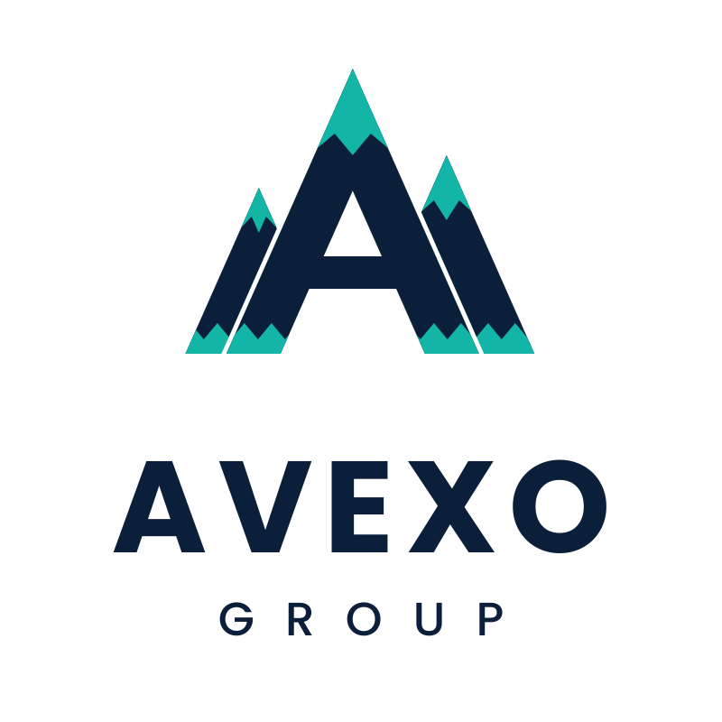

# Avexo Group: brand assets

Official logo files for Avexo Group, a Moldovan technology holding company.

<picture>
  <source media="(prefers-color-scheme: dark)" srcset="logo/avexo-mountains-dark.svg">
  
</picture>

## Files

| File | Use |
|---|---|
| `logo/avexo-mountains-light.svg` | Full lockup on a white background |
| `logo/avexo-mountains-dark.svg` | Full lockup on a navy background |
| `logo/avexo-mountains-symbol.svg` | Symbol only, no text |

## Palette

- Navy `#0B1F3A`
- Teal `#12B5A6`
- White `#FFFFFF`

## About the design

The symbol is built from three mountains. The tallest, in the middle, forms the letter "A". Snow-capped peaks and a snow line at the base tie the three together.

## License

All rights reserved. See [NOTICE](NOTICE). The name and logo are proprietary and may not be copied or reused without written permission.
